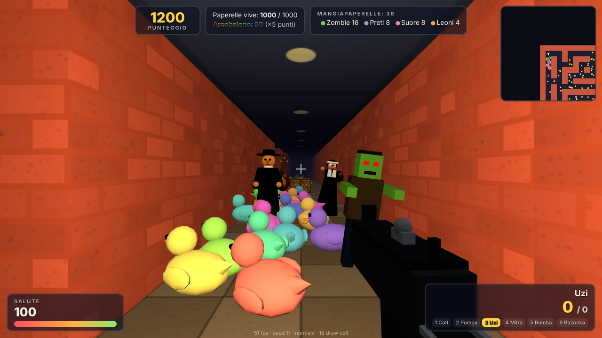

# Paperelle nel Labirinto

Sparatutto 3D in prima persona che gira nel browser: mille paperelle colorate vagano in un labirinto e zombie, preti, suore spippate e leoni se le mangiano. Il tuo punteggio sono le paperelle che riesci a salvare.

**▶ Gioca subito: https://aldexxx86.github.io/labirinto-paperelle/**

## Come si gioca

Elimina tutti i mangiapaperelle prima che finiscano le paperelle.

- **Vittoria**: tutti i nemici eliminati e almeno una paperella ancora viva.
- **Game over**: muori, oppure tutte le paperelle vengono mangiate.

### Punteggio

- Ogni paperella viva vale **1 punto**, quelle **arcobaleno 5 punti**.
- Il punteggio cala ogni volta che una paperella viene mangiata.
- Puoi colpire le paperelle, ma perdi il loro valore più una penalità (−3 per una normale, −15 per una arcobaleno).
- Le vittorie entrano nella **classifica top 10** per difficoltà (facile, normale, difficile).

### Nemici

| Nemico | Comportamento |
|---|---|
| Zombie | Lenti e resistenti; il morso ti fa sanguinare per qualche secondo |
| Preti | Velocissimi, divorano le paperelle e colpiscono con una mazza |
| Suore spippate | Si muovono a scatti e girano su sé stesse; sparano da lontano |
| Leoni | I più forti; quando ti vedono ti caricano |

### Armi e casse

Pistola Colt (munizioni infinite), fucile a pompa, Uzi, mitragliatrice, bombe a mano e bazooka. Le casse con il punto di domanda si aprono passandoci sopra o sparandoci e contengono kit di soccorso, munizioni o armi; ricompaiono dopo un po' in altri punti del labirinto.

### Comandi

| Tasto | Azione |
|---|---|
| W A S D | Muoversi |
| Mouse / clic | Mirare / sparare |
| Shift | Correre |
| 1–6, rotella | Cambiare arma |
| R | Ricaricare |
| M | Mappa grande |
| Esc | Pausa |

### Da telefono o tablet

Il gioco funziona anche su mobile, meglio in orizzontale: joystick a sinistra per muoversi (spinto fino in fondo per correre), trascina il dito sulla metà destra per guardarti intorno, tieni premuto **FUOCO** per sparare. ◀ ▶ cambiano arma, **R** ricarica, **MAPPA** ingrandisce la mappa, **II** mette in pausa.

Nel menu iniziale c'è anche il pulsante **Guida al gioco**.

## Avviarlo in locale

Basta aprire `index.html` in Chrome, Edge o Firefox. Serve la connessione a internet, perché Three.js e Firebase vengono caricati da CDN.

Parametri utili nell'indirizzo: `?diff=facile|normale|difficile`, `?seed=123` (stesso labirinto), `?ducks=500`.

## Tecnologie

- [Three.js](https://threejs.org/) (WebGL) per la grafica 3D, con instancing per disegnare mille paperelle in poche chiamate.
- Modelli, texture e suoni sono generati via codice: non ci sono file esterni.
- [Firebase Firestore](https://firebase.google.com/) per la classifica online, con classifica locale nel browser quando si è offline.
- Pubblicato con GitHub Pages.

Il piano di progetto è in [docs/piano-di-progetto.md](docs/piano-di-progetto.md).

## Crediti e licenza

Creato da **Matteo Alderighi**, Firenze, Italia, 2026.
Il gioco è stato realizzato con l'aiuto dell'intelligenza artificiale (Claude di Anthropic).
[LinkedIn](https://www.linkedin.com/in/matteo-alderighi) · aldeandroid@gmail.com

Rilasciato con licenza [MIT](LICENSE).
